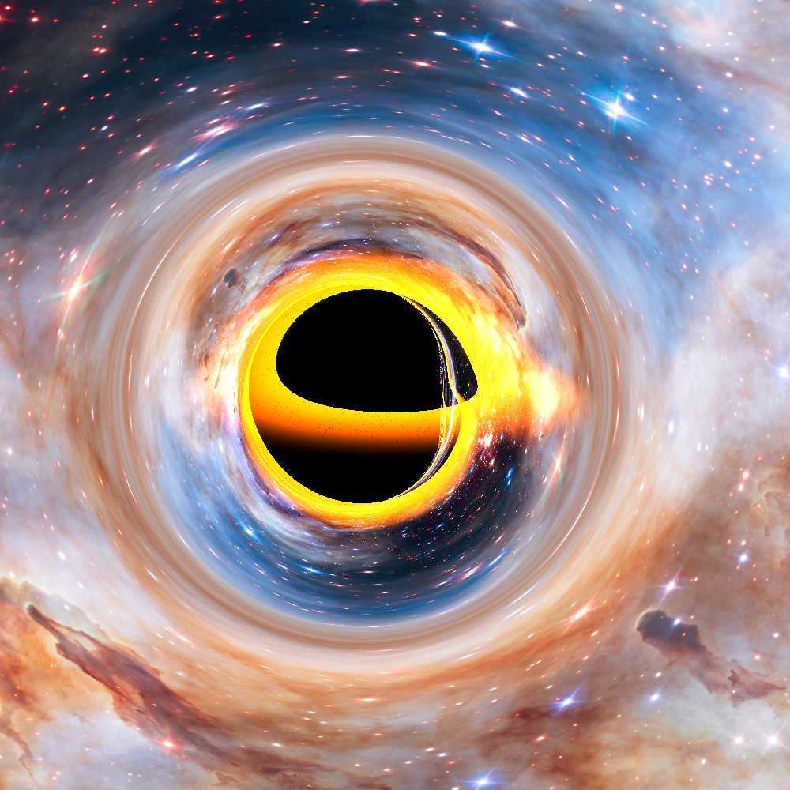

# Array fire Raytracing black hole
#### Discover the fascinating science behind black hole raytracing and how it transforms our understanding of these cosmic giants” you won't believe what light reveals!

After Albert Einsteins proposal of the General Theory of Relativity, our outlook on how gravity works has changed significantly opening the possibility of mystifying objects such as Black Holes. Black Holes are massive compact objects resulting from unhalted gravitational collapse. Their gravity affects the spacetime surrounding it to such an extreme level that any object near it, including light, will have as an unavoidable future a path of falling towards the black hole.

While the theory of **general relativity** was proven to be highly accurate from experiments testing the bending of light seen during an eclipse or the gravitational time dilation experience of objects closer to massive objects, there had not been a direct observation of a black hole until a few years ago. The Event Horizon Telescope Collaboration was able to combine the power of multiple telescopes around Earth to capture an image of the supermassive black hole at the center of our galaxy, Sagittarius A Black Hole (EHT Collaboration).

However, a valid question arises from such an achievement: How do we know what the image of a black hole should look It turns out that the answer is both easier and harder than one expects: raytracing a black hole.

---
Computing the light paths is half the work, the remaining part is computing the color of each pixel. For this simple scene, we need to consider three things:

1. Does the light ray fall inside the black hole?
2.  Does the light ray cross the accretion disk?
3. What is the final direction the light ray points to in the background?
---

To *compute how light will travel in spacetime*, we require the initial velocity 4-vector and position **4-vector**. These 4-vectors are the combination of the normal 3d space

|r1|r2|r3|r4|
|--|--|--|--|
|x|xy|xyz|xyzw|

tabel diatas merupaka representasi nilai vektor dalam ruang R^n

---

conclusion

- By combining some basic ideas of raytracing, the mathematical foundations of spacetime curvature, and some numerical methods we can create a black hole raytracer and generate images that inform us of what black holes can do to spacetime by visualizing their effects on the light captured by a camera.

---

berikut adalah link sumber artikel diatas [link](https://arrayfire.com/blog/raytracing-a-black-hole/)
